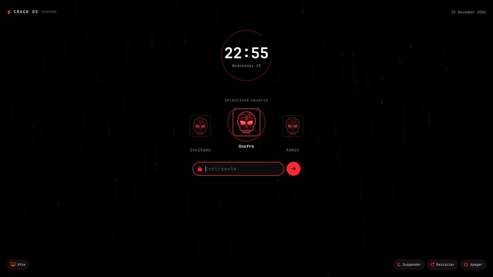
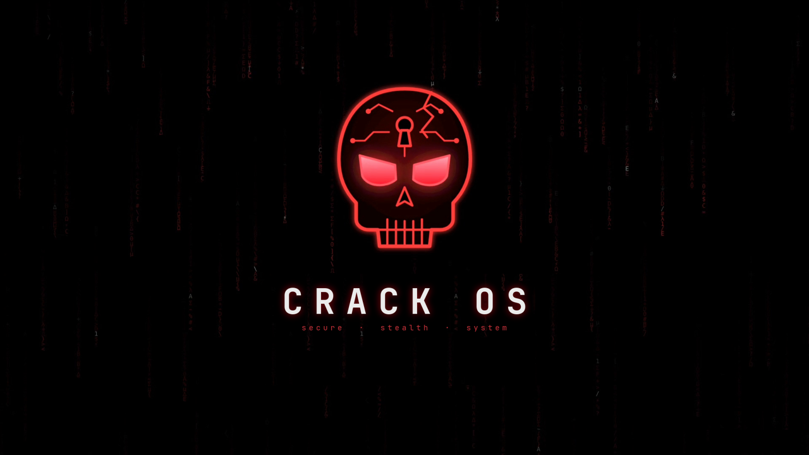
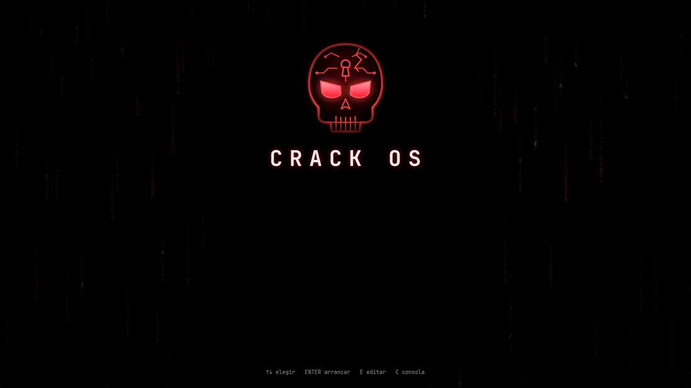

# Crack OS

Sistema operativo de uso diario basado en **Debian 13 "trixie" (estable)**, con escritorio **Hyprland**
configurado a mano en negro y rojo, animación de arranque con la calavera de Crack OS, **modo seguro**
que borra todo al reiniciar y **llave USB opcional** para el modo normal.

| Pantalla de acceso | Escritorio | Menú de arranque |
|---|---|---|
|  |  |  |

## Qué incluye

- **Arranque**: menú GRUB propio, animación Plymouth con la calavera del video (aparece, brillan los
  ojos en bucle y hace *glitch* de vez en cuando), barra de progreso y campo de contraseña para discos cifrados.
- **Pantalla de acceso** (tema SDDM propio): selección de usuarios con flechas o clic, reloj,
  selector de sesión, suspender / reiniciar / apagar. Indica cuando estás en modo seguro.
- **Escritorio Hyprland**: ventanas con esquinas redondeadas, bordes rojos animados, desenfoque y
  transparencia; barra flotante (Waybar) con escritorios tipo pastilla, reloj y calendario, multimedia, CPU/RAM,
  red, Bluetooth, volumen, brillo, batería, notificaciones y menú de energía; lanzador Wofi; centro de
  notificaciones (SwayNC) con volumen, brillo y reproductor; bloqueo con Hyprlock; capturas de pantalla;
  tema GTK oscuro con acento rojo, iconos Papirus con carpetas rojas, fuente JetBrainsMono Nerd Font.
- **Terminal** (Kitty translúcida): paleta roja/negra, prompt de dos líneas con usuario, carpeta, rama git y
  código de error, `fastfetch` con la calavera al abrir.

### Atajos principales (Super = tecla Windows, `Super + F1` muestra todos)

| Atajo | Acción |
|---|---|
| Super + Espacio | Aplicaciones |
| Super + Enter | Terminal |
| Super + E / B | Archivos / Navegador |
| Super + Q | Cerrar ventana |
| Super + 1…6 | Escritorios |
| Super + N | Centro de notificaciones |
| Super + L | Bloquear |
| Super + Shift + E | Menú de energía |
| Impr Pant | Captura de área |
| Super + Shift + W | Cambiar fondo |
- **Software**: Firefox ESR, Thunar, Mousepad, Ristretto, VLC, gestor de archivos comprimidos, GParted,
  Discos, Synaptic, impresoras, Wi-Fi/Bluetooth, PipeWire. Actualizaciones de seguridad de Debian
  (`update` en la terminal = `sudo apt update && sudo apt full-upgrade`).
- **Instalador** gráfico (Calamares) con la marca Crack OS.

## Modos de arranque

| Entrada del menú | Qué pasa |
|---|---|
| **Crack OS** | Modo normal. Usuarios, contraseñas y archivos se guardan. |
| **Crack OS // Modo Seguro (nada se guarda)** | El disco se monta en solo lectura y todos los cambios van a la RAM. Al reiniciar o apagar, todo lo hecho en la sesión desaparece. |
| **Crack OS Live (nada se guarda)** | Desde la USB, sin instalar. Usuario `crack`, contraseña `live`. |

En modo seguro el escritorio muestra un fondo y un aviso distintos, y la terminal marca `[MODO SEGURO]`.
El disco real queda visible (solo lectura) en `/media/crack-disk`.

## Llave USB (opcional, desactivada)

```bash
lsblk                                   # identifica tu USB, p. ej. /dev/sdb1
sudo crackos-usbkey create /dev/sdb1    # guarda una llave aleatoria (.crackos.key) en la USB, no borra nada
sudo crackos-usbkey enable              # a partir del siguiente arranque se exige la USB
sudo crackos-usbkey status
sudo crackos-usbkey fallback poweroff   # sin llave: apagar (por defecto: arrancar en modo seguro)
sudo crackos-usbkey disable
```

Al arrancar en modo normal, la animación muestra *"INSERTA TU LLAVE USB DE CRACK OS"* y espera 60 s.
Si pierdes la llave, entra en **Modo Seguro** y ejecuta `sudo crackos-usbkey disable --disk`.

> Importante: la llave es un control de arranque, **no cifra tus datos**. Para protección real
> marca "Cifrar el sistema" en el instalador.

## Compilar tú mismo

En Debian 13 (o cualquier Linux con Docker):

```bash
sudo ./build.sh                                     # en Debian 13
# o
sudo docker run --rm --privileged -v "$PWD":/build -w /build debian:trixie ./build.sh
```

Los gráficos se regeneran desde el video con `python3 tools/make_assets.py` (ffmpeg + Pillow).
La pantalla de acceso se puede previsualizar sin SDDM con `python3 tools/preview_sddm.py salida.png`.

## Estructura

```
auto/config                     opciones de live-build (Debian 13, amd64, ISO híbrida UEFI+BIOS)
build.sh                        compila la ISO
config/package-lists/           paquetes del sistema
config/hooks/normal/            personalización durante la compilación
config/includes.chroot/         archivos que se copian al sistema (temas, scripts, configuración)
  etc/initramfs-tools/scripts/  modo seguro (overlayfs en RAM) y llave USB
  etc/grub.d/11_crackos_safe    entrada "Modo Seguro" en GRUB
  usr/share/plymouth/themes/    animación de arranque
  usr/share/sddm/themes/        pantalla de acceso
  usr/local/bin/                crackos-usbkey, crackos-session
config/bootloaders-overlay/     fondos del menú de la USB
assets/                         video original y fuentes
tools/                          generadores de gráficos y vista previa
```

Licencias: fuentes JetBrains Mono (OFL), tema Matcha (GPL-3.0), Papirus (GPL-3.0), Hyprland (BSD-3), Debian y sus paquetes según sus licencias.
